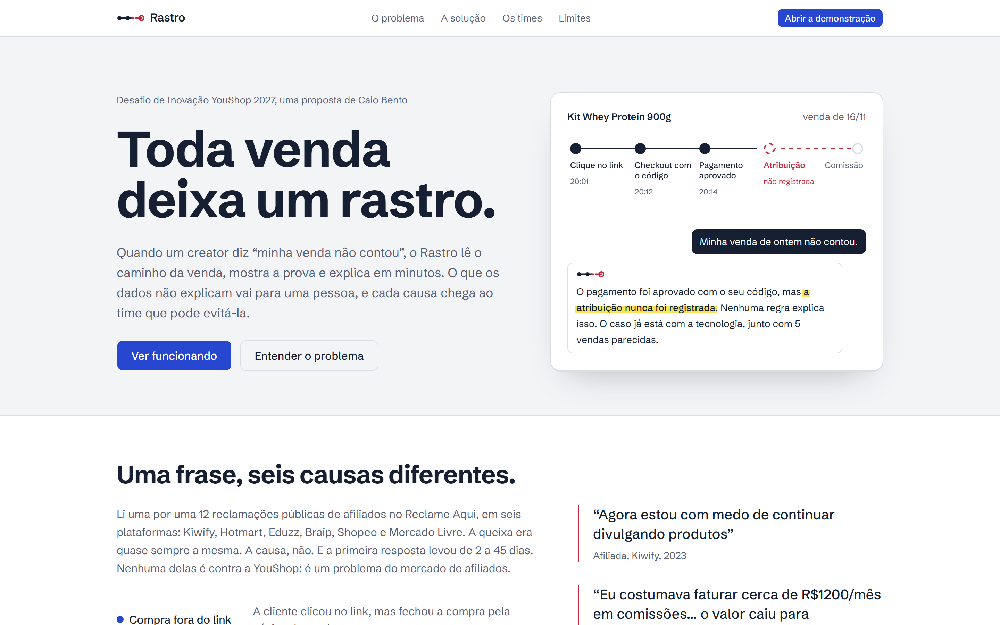
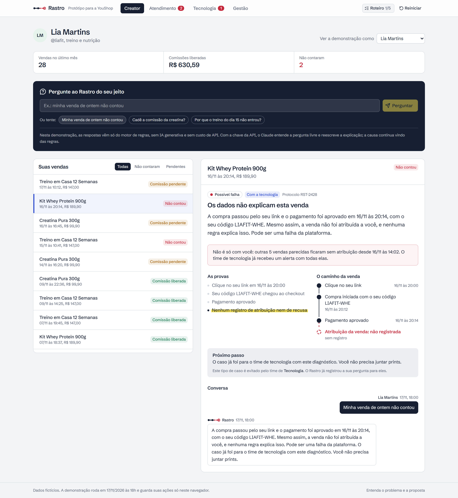
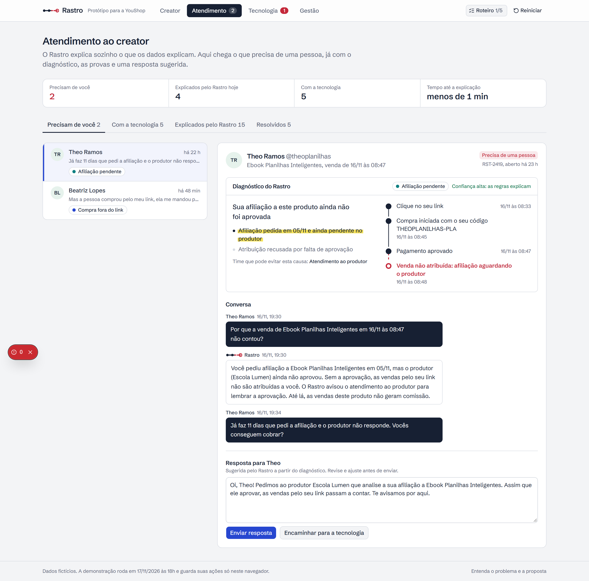
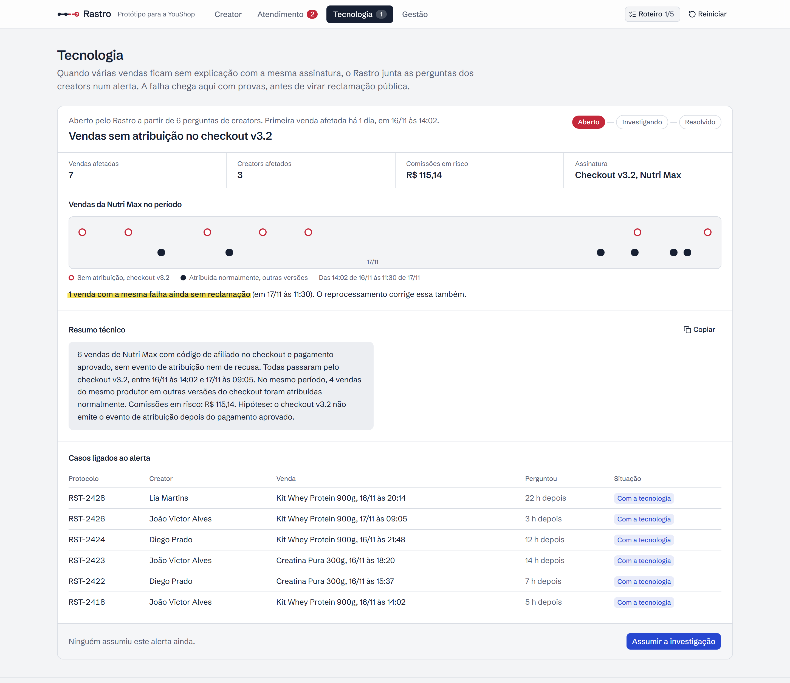
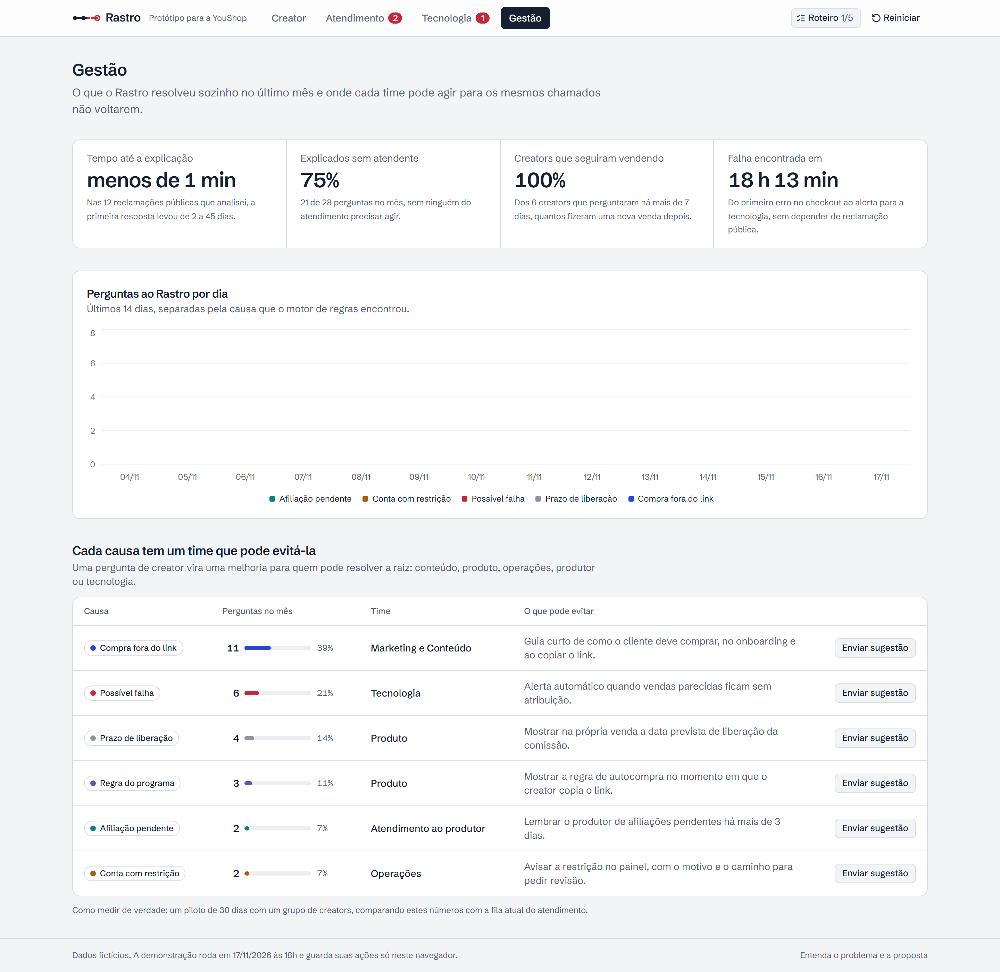
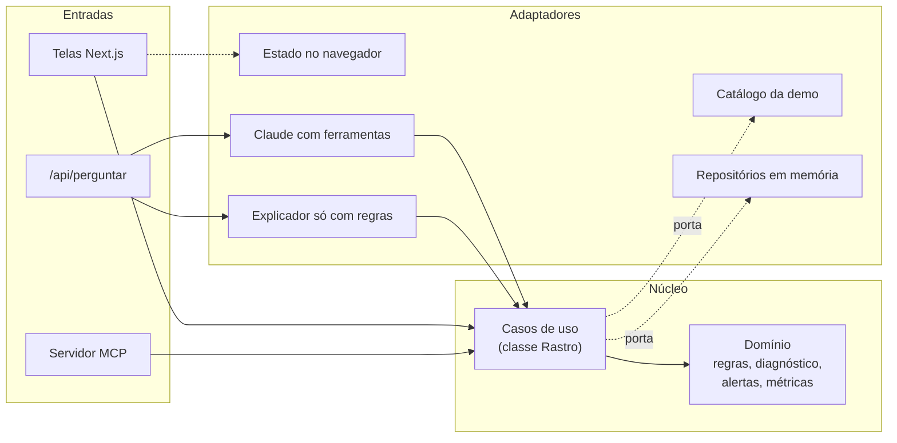
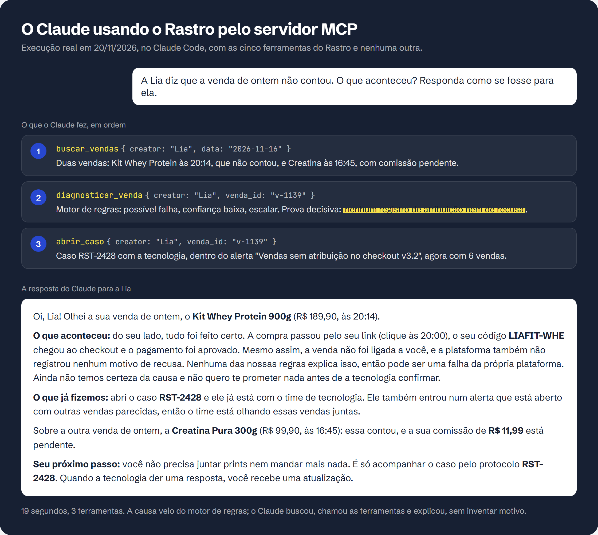

# Rastro

**Toda venda deixa um rastro.** Quando um creator diz "minha venda não contou", o Rastro lê o caminho da venda, mostra a prova e explica em minutos. O que os dados não explicam vai para uma pessoa, e cada causa chega ao time da empresa que pode evitá-la.

Protótipo de Caio Bento para o **Desafio de Inovação YouShop 2027**.

[](https://github.com/caiobento7/rastro/actions/workflows/ci.yml)

**Demonstração:** [rastro-pearl.vercel.app](https://rastro-pearl.vercel.app) (dados fictícios, funciona sem login)



## O problema

Li 12 reclamações públicas de afiliados em seis plataformas ([evidências](docs/evidencias.md)). A queixa é quase sempre a mesma frase, mas esconde seis causas diferentes: compra fora do link, regra do programa, prazo de liberação, conta com restrição, afiliação pendente ou falha da plataforma. A primeira resposta levou de 2 a 45 dias. Enquanto espera, o creator desconfia e para de divulgar.

Três lados perdem:

- **o creator**, que não sabe se errou, se foi uma regra ou se a plataforma falhou;
- **o atendimento**, que investiga caso a caso chamados iguais com causas diferentes;
- **a tecnologia**, que é interrompida, e vê uma falha real se esconder no meio das dúvidas.

## A solução

1. **Lê o rastro da venda.** Clique no link, checkout, pagamento, atribuição, entrega e comissão: eventos que a plataforma já registra.
2. **As regras decidem.** Um motor de regras testado aponta a causa e a prova decisiva. A IA nunca escolhe o motivo ([ADR 0001](docs/adr/0001-regras-decidem-ia-explica.md)).
3. **A IA explica.** Em linguagem simples, com o caminho da venda e o próximo passo. Se os dados não explicam, ela diz que não sabe.
4. **O time certo recebe.** Contestações vão ao atendimento com resposta sugerida. Vendas parecidas sem explicação viram um alerta para a tecnologia ([ADR 0004](docs/adr/0004-falhas-em-grupo-viram-alerta.md)). Cada causa vira uma sugestão para o time que pode evitá-la.

| Quando a causa é | Quem recebe | O que pode mudar |
|---|---|---|
| Compra fora do link | Marketing e Conteúdo | Guia curto de como o cliente deve comprar |
| Regra do programa | Produto | Mostrar a regra de autocompra ao copiar o link |
| Prazo de liberação | Produto | Mostrar na venda a data prevista da comissão |
| Conta com restrição | Operações | Avisar a restrição no painel, com o caminho para revisão |
| Afiliação pendente | Atendimento ao produtor | Lembrar o produtor de afiliações paradas |
| Possível falha | Tecnologia | Alerta automático de vendas parecidas sem atribuição |

## As quatro telas

A demonstração tem um mês de vendas fictícias e um roteiro de 5 passos. O que você faz numa área aparece nas outras.

| Creator | Atendimento |
|---|---|
|  |  |
| **Tecnologia** | **Gestão** |
|  |  |

- **Creator:** a Lia pergunta do jeito dela ("minha venda de ontem não contou"), vê a prova grifada, o caminho da venda e o próximo passo. Se discordar, pede uma pessoa.
- **Atendimento:** só chega o que precisa de gente, com diagnóstico, provas e uma resposta já escrita para revisar.
- **Tecnologia:** um alerta junta as vendas que falharam no checkout v3.2, compara com as que passaram por outra versão e mostra até a venda com falha que ninguém reclamou. Ao resolver, cada creator recebe a resposta.
- **Gestão:** tempo até a explicação, quanto o Rastro resolveu sozinho, quantos creators seguiram vendendo e qual time pode evitar cada causa.

## Arquitetura

Núcleo isolado com portas e adaptadores ([ADR 0002](docs/adr/0002-arquitetura-hexagonal.md)). O mesmo núcleo atende as telas, a rota de IA, o servidor MCP e os testes.



```
src/
  core/domain        regras e diagnóstico, alertas, métricas, formatação. TypeScript puro.
  core/application   casos de uso em módulos (consultas, atendimento, alertas da tecnologia,
                     painel da gestão), a fachada Rastro, as portas e a interpretação da pergunta.
  adapters/demo      dados fictícios determinísticos e o histórico de um mês.
  adapters/ia        Claude com tool use e o explicador só com regras.
  adapters/memoria   catálogo e repositórios em memória.
  lib/demo           estado da demonstração no navegador (useSyncExternalStore + localStorage).
  app                páginas e a rota /api/perguntar.
  components         telas e peças visuais (shadcn/ui sobre Base UI, Tailwind).
mcp/                 servidor MCP e teste de ponta a ponta do protocolo.
tests/unit           Vitest: domínio, casos de uso, dados e rota HTTP.
tests/e2e            Playwright: o fluxo entre os quatro times, no computador e no celular.
docs/adr             decisões de arquitetura.
```

As fronteiras são verificadas no CI pelo `dependency-cruiser`: o domínio não importa nada de fora, a aplicação só usa o domínio, adaptadores não conhecem telas e componentes não chamam a IA direto.

### Decisões

- [0001: As regras decidem a causa, a IA só explica](docs/adr/0001-regras-decidem-ia-explica.md)
- [0002: Núcleo isolado com portas e adaptadores](docs/adr/0002-arquitetura-hexagonal.md)
- [0003: Estado da demonstração no navegador](docs/adr/0003-estado-da-demo-no-navegador.md)
- [0004: Perguntas parecidas sem explicação viram um alerta](docs/adr/0004-falhas-em-grupo-viram-alerta.md)
- [0005: Privacidade por padrão](docs/adr/0005-privacidade-por-padrao.md)
- [0006: Limite de uso na rota de IA](docs/adr/0006-limite-de-uso-da-ia.md)

## Qualidade

O CI roda a cada push:

| Etapa | Comando |
|---|---|
| ESLint | `npm run lint` |
| TypeScript estrito | `npm run typecheck` |
| Regras de arquitetura | `npm run arquitetura` |
| 65 testes unitários com cobertura mínima | `npm run test:cobertura` |
| Servidor MCP de ponta a ponta | `npm run mcp:testar` |
| Build de produção | `npm run build` |
| 11 testes de ponta a ponta (computador e celular) | `npm run test:e2e` |

Alguns testes que contam a história: a mesma venda sempre tem a mesma causa; uma pergunta fora do assunto ("oi") não abre caso; venda de outro creator não é diagnosticada; nenhum diagnóstico tem dados do comprador; a pergunta da Lia faz o alerta crescer de 5 para 6 vendas; resolver o alerta encerra todos os casos ligados; a página não tem rolagem horizontal no celular; o caminho com o Claude é testado com um cliente falso, sem gastar API.

## Rodar localmente

Requer Node.js 20 ou mais novo.

```bash
npm ci
npm run dev          # http://localhost:3200
npm run verificar    # lint, tipos, arquitetura e testes unitários
npx playwright install chromium
npm run test:e2e
```

### IA de verdade (opcional)

Sem chave, a rota `/api/perguntar` responde só com as regras, e é assim que a demonstração publicada funciona. Com ou sem chave, cada origem pode fazer até 10 perguntas por minuto, para a rota não virar uma fonte de custo aberta ([ADR 0006](docs/adr/0006-limite-de-uso-da-ia.md)). Para usar o Claude com ferramentas, copie `.env.example` para `.env.local` e preencha `ANTHROPIC_API_KEY`. A causa continua vindo do motor de regras; a IA só entende a pergunta e reescreve a explicação.

### Servidor MCP

O mesmo núcleo também roda como servidor MCP. Um assistente compatível (Claude Desktop, Claude Code e outros) chama as ferramentas `listar_creators`, `buscar_vendas`, `diagnosticar_venda`, `abrir_caso` e `listar_alertas`, e explica o resultado.

```bash
npm run mcp:testar                     # empacota e testa por um cliente MCP
claude mcp add rastro -- node mcp/dist/rastro-mcp.mjs
```

Depois, pergunte: *"A Lia diz que a venda de ontem não contou. O que aconteceu?"*

**Funcionando de verdade.** Execução real em 20/11/2026, no Claude Code em modo não interativo, com o servidor do Rastro e nenhuma outra ferramenta liberada. O Claude buscou as vendas de 16/11, rodou o diagnóstico, abriu o caso e explicou para a Lia sem inventar a causa:



Para repetir sem mudar a sua configuração do Claude Code:

```bash
npm run mcp:build
claude -p "A Lia diz que a venda de ontem não contou. O que aconteceu?" \
  --mcp-config mcp/claude-mcp.json --strict-mcp-config \
  --allowedTools "mcp__rastro__buscar_vendas,mcp__rastro__diagnosticar_venda,mcp__rastro__abrir_caso"
```

## Limites e cuidados

- **Privacidade:** o creator nunca vê dados do comprador, só se eles coincidem com os dele ([ADR 0005](docs/adr/0005-privacidade-por-padrao.md)).
- **Antifraude:** o Rastro explica a regra sem revelar os sinais usados para detectar fraude.
- **Quando a IA erra:** confiança baixa e contestações vão para uma pessoa. A IA não inventa motivo.
- **Limite principal:** o Rastro só explica o que a plataforma registra. Se um evento não foi gravado, ele escala em vez de adivinhar.
- **Dados:** tudo aqui é fictício. Nenhum nome, marca ou venda é real.

## Autor

**Caio Bento**, desenvolvedor full stack e estudante de Engenharia de Computação na UERJ.
[LinkedIn](https://www.linkedin.com/in/caiobentoo) · [GitHub](https://github.com/caiobento7) · [Portfólio](https://caiobento.vercel.app)
